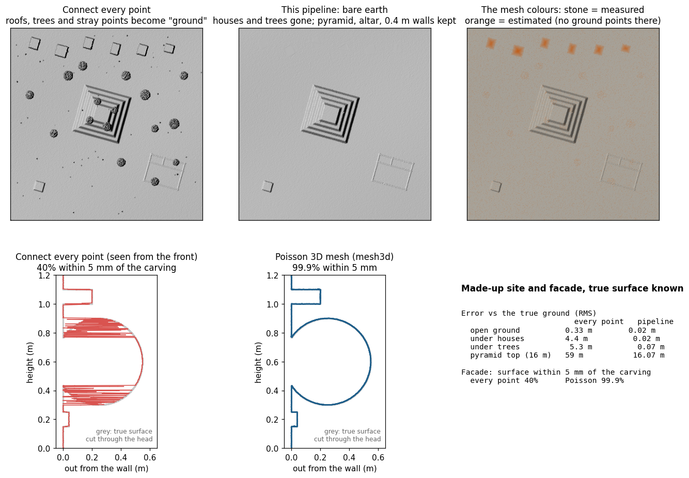

# surface: lidar to a solid surface, the same way for every case study

`surface.py` turns the team's lidar into a bare-earth surface (DTM), relief views and a solid mesh. It runs every case study in a settings file the same way and records exactly how each one was made. It runs on the lab machine; nothing is sent anywhere. **Never paste its outputs into an AI chat**: a surface made from the team's lidar is the team's data.

## Why connecting every point gives a poor surface

Joining every lidar point with triangles is the natural first try. On a made-up site with a known true ground, it goes wrong in three ways:

1. **Not every point is ground.** Roofs, tree crowns, birds and multipath returns all become part of the surface. Under houses and trees the triangles were 4–5 m off, and one bird put the pyramid's top 59 m too high.
2. **Every point's noise stays in.** A triangle passes exactly through each point, so the few centimetres of noise in every return become a crumpled surface. Averaging the points in each cell removes most of it.
3. **The surface can't be sharper than the points.** At 10 points per m², points are about 30 cm apart. No method can recover detail smaller than that from the same points: not a filter, not a finer grid, not AI. Anything finer that appears is invented.

Sculpture runs into the third limit and one more. Airborne lidar sees the world from above, so it captures nothing of a vertical carved face and nothing under an overhang. Sculpture needs a close-range scan (terrestrial laser scanner, or photogrammetry from many photos) and a true 3D mesh, not a surface seen from one direction. That is `surface.py mesh3d`, below.

## What the tests show (made-up data, known true surface)



| | Connect every point | This pipeline |
|---|---|---|
| Open ground (RMS error) | 0.33 m | 0.02 m |
| Under houses | 4.4 m | 0.02 m |
| Under trees | 5.3 m | 0.07 m |
| Stepped pyramid, 16 m | top at 59 m (a bird) | 16.07 m |
| Altar, 1.5 m | 1.50 m | 1.50 m |
| Low walls, 0.4 m | 0.37 m | 0.38 m |

For the carved facade (a 2 m panel with a projecting head and a cornice that overhang, scanned at about 2 mm spacing):

| | Connect every point (seen from the front) | Poisson mesh (`mesh3d`) |
|---|---|---|
| Surface within 5 mm of the true carving | 40% | 99.9% |
| Worst 1% | 137 mm off | 2 mm off |

## Setup (once, on the lab machine)

Install [Miniforge](https://github.com/conda-forge/miniforge) (conda), then:

```bash
conda env create -f lidar/environment.yml
conda activate teo-lidar
python -m pytest lidar/tests -q          # about 2 minutes, made-up data only
```

## Steps

```bash
# 1. Describe the case studies: copy the example next to the data and edit it
cp lidar/cases.example.toml cases.toml

# 2. Check what each case will do, without running anything
python lidar/surface.py run cases.toml --dry-run

# 3. Run every case (or some: --only case-study-a case-study-b)
python lidar/surface.py run cases.toml
```

Each case gets its own folder in `surfaces/`:

| File | What it is |
|---|---|
| `dtm.tif` | Bare earth. Each cell with 2 or more ground points takes their mean; other cells are interpolated across the triangles between ground points |
| `points.tif` | Ground points per cell. **0 = no measurement: the surface there is an estimate** |
| `gap.tif` | Metres from each cell to the nearest measured cell |
| `removed.tif` | Height of everything the ground filter took away: trees, houses, and any ancient feature it took by mistake |
| `hillshade.tif`, `slope.tif`, `slrm.tif` | Relief views. The hillshade lights from several directions, so edges running toward a single sun don't disappear |
| `surface.ply`, `surface.obj` | The DTM as a solid mesh, for Blender, Unreal, CloudCompare or a web viewer. Stone-coloured where measured, orange where estimated (stronger the farther from a measurement). The PLY also carries `gap_m` per vertex |
| `classified.laz`, `ground.laz` | Every point with its class, and the ground points alone |
| `dsm.tif` | Highest point per cell, trees and houses included (context) |
| `run.json` | Every setting, the exact PDAL pipelines, tool versions, file hashes and counts |

`surfaces/cases.csv` puts the case studies side by side: density, cell size, share of cells measured, and a **settings fingerprint**. Two cases are made the same way only if their fingerprints match.

Mesh coordinates are shifted to a round local origin: real coordinates lose millimetres in the 32-bit numbers most 3D software uses. The offset is written in the file (`comment offset` in the PLY, `# offset` in the OBJ) and in `run.json`. Add it back to get survey coordinates.

## Check every case before using it

1. **Open `removed.tif` over `hillshade.tif` in QGIS.** Trees and houses should be there; platforms, altars and mounds should not. If an ancient feature was removed, change that case's settings (below) and run it again.
2. **Open `classified.laz` in CloudCompare** coloured by classification, to see the same thing point by point.
3. **Look at `points.tif` or the mesh colours.** Large orange areas (under buildings, dense trees, water) are guesses, and nothing measured there should come from the mesh.

## The ground filter: settings decide what survives

To a ground filter, a 1.5 m platform and a low house have the same shape. The test site has a stepped pyramid, a 1.5 m × 10 m altar, 0.4 m walls, houses 3–6 m tall and trees:

| Settings | Altar (1.5 m) | Pyramid top (16 m) | Error under trees |
|---|---|---|---|
| SMRF, this tool's defaults (slope 0.6, window 14) | 1.50 m | 16.07 m | 0.07 m |
| SMRF, PDAL's own defaults (slope 0.15, window 18) | 0.52 m | 15.07 m | 0.33 m |
| CSF cloth filter | 0.36 m | 0.98 m (flattened) | 5 m |

The vendor's own classification (`ground = "delivered"`) has the same risk, since vendors use the same kinds of filters. Check `removed.tif` either way. When a case needs different settings, record why in its `note`. These are made-up houses and features: the real valley's buildings may be larger or lower, so treat these defaults as a starting point, not a guarantee.

## How fine can the surface be?

`resolution = "auto"` picks cells holding about two ground points each: √(2 / ground points per m²), rounded up to 5 cm. Use the density of ground points, not all points; trees and roofs take a share.

| Ground points per m² | Cell size | Smallest feature it shows reliably (2–3 cells) |
|---|---|---|
| 2 | 1.0 m | 2–3 m |
| 5 | 0.65 m | 1.5–2 m |
| 10 | 0.45 m | about 1 m |
| 20 | 0.35 m | 0.7–1 m |
| 50 | 0.2 m | about 0.5 m |

A finer grid than this doesn't add detail. It adds interpolation, and `points.tif` will show mostly zeros. Measurements of the designed unit come from the excavation drawings (the CAD tool), never from these surfaces: at these spacings, the lidar can place a building but cannot measure an 83 cm unit within it.

## Sculpture and close-range scans: `mesh3d`

```bash
python lidar/surface.py mesh3d scan.ply -o surfaces/facade-scan
python lidar/surface.py mesh3d scan.xyz -o surfaces/facade-scan --toward 512001,2176005,2281   # scanner position
```

- **Input:** a dense point cloud from a terrestrial scanner or photogrammetry (Metashape, RealityCapture, COLMAP): PLY, LAS/LAZ or XYZ text. Export **normals** if the software offers them; they say which way each surface faces. Without them, normals are estimated (same accuracy in the test, about 12 s for 260,000 points).
- **Method:** screened Poisson reconstruction, which builds a closed 3D surface, so undercuts and overhangs come out right.
- **Estimated surface is cut:** Poisson also closes surfaces the scanner never saw. Every vertex gets its distance to the nearest scanned point (`gap_m` in the PLY). Anything beyond 3× the point spacing is removed (`--keep-within` to change it). What remains is coloured by that distance.
- **Resolution:** `--depth 10` gives cells of about 1/1000 of the object's size (2 mm on a 2 m panel). Each step up halves the cell size and needs about 4× the memory.

A scanned sculpture and the airborne lidar can share coordinates if the scan is georeferenced (surveyed targets or GNSS). Then the facade mesh sits on the site surface, each with its own record of what was measured.

## Tests

```bash
python -m pytest lidar/tests -q
```

`test_surface.py` builds the made-up site and facade (`synth_lidar.py`) and checks the numbers above. It also checks that estimated cells are flagged, that the mesh matches the DTM to the millimetre, that the same settings give the same files (byte for byte) and that mistakes in the settings file are caught. Other tools in this folder that share the made-up site keep their own tests here too.
