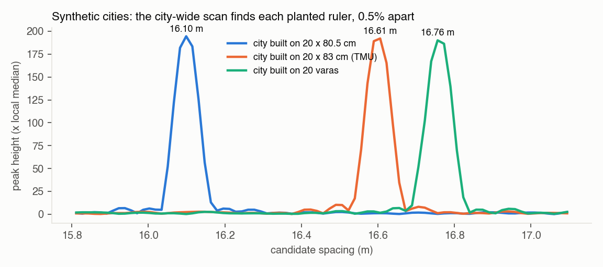
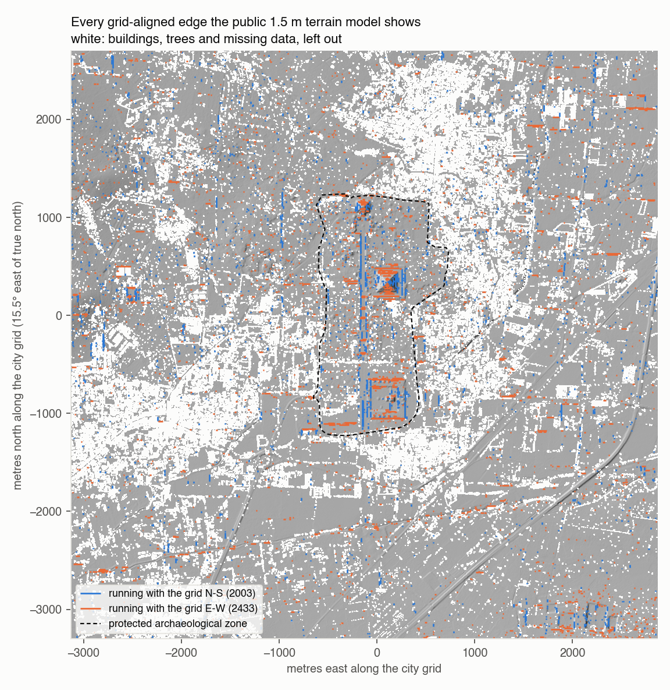
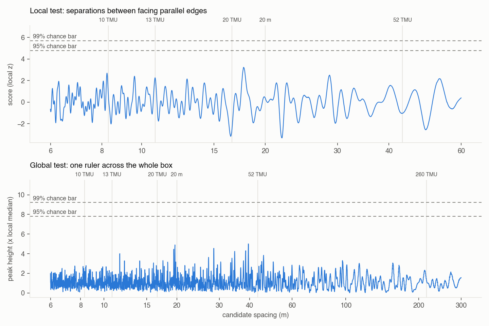

# City-scale spacing pilot on public lidar

**Question:** across Teotihuacan, do grid-aligned walls, platforms and boundaries sit at a shared spacing: 20 TMU (16.6 m), 10 or 13 TMU, 52 or 260 TMU, the colonial vara, or round metres?

**What the public data shows:** in a 6 × 6 km box on the INEGI 1.5 m terrain model, 4,436 grid-aligned edges show no spacing that clears the chance bar, and nothing replicates across the west and east halves of the city. That is a statement about this data, not about the 83 cm unit. At 1.5 m, the public terrain cannot separate ancient edges from modern ones, and it is mostly modern (see [What the null means](#what-the-null-means)). The pilot's real output is a tested method, ready for the team's own lidar and drawings.

Code: [`recon/lattice.py`](../lattice.py). It uses only public data (INEGI, OpenStreetMap) and synthetic cities: none of the team's lidar, drawings or results.

## How it works

- **No hand-picked lines.** Every straight edge within 3° of the 15.5° grid is extracted from the terrain automatically, and every spacing is scanned at once.
- **Two tests.**
  - *Local:* separations between all pairs of parallel edges that face each other (5–600 m apart), scored with Kendall's cosine quantogram for spacings of 6–60 m.
  - *Global:* the periodogram of all edge positions along each grid axis, 6–300 m. It asks whether the whole city sits on one ruler with one origin.
- **Chance bar from fake cities.** The same edges are cut into 300 m tiles. For the local test each tile is stretched (±15%) and shifted (±50 m) at random; for the global test each tile is shifted (±1 km) at random. Each tile keeps its own shapes, but any spacing shared between tiles is broken. The tallest peak anywhere in each fake scan sets the 95% and 99% bars, which accounts for having looked at every spacing.
- **Fixed in advance:** the target spacings (`TARGETS`) and the decision rule. A spacing counts as found only if it clears the 99% bar for the whole box and also reaches p < 0.05 at the same spacing in the west and east halves, scanned separately.

## Check 1: synthetic cities with a known answer

Six 4 × 4 km synthetic terrains (eroded compounds plus modern field ridges, 1.5 m pixels) go through the same code.



| City built on | Planted | Global test found | 95% interval | Local test found |
|---|---|---|---|---|
| 20 × 83 cm (TMU) | 16.60 m | 16.601 m | 16.599–16.602 | 16.61 m |
| 20 × 80.5 cm | 16.10 m | 16.101 m | 16.099–16.102 | 16.10 m |
| 20 varas | 16.76 m | 16.759 m | 16.758–16.760 | 16.77 m |
| 20 m | 20.00 m | 20.000 m | 19.998–20.002 | 20.00 m |
| 16.6 m within neighbourhoods only | 16.60 m | no city-wide ruler (correct) | – | 16.59 m |
| no unit | – | nothing | – | nothing above the 99% bar |

- **TMU, 80.5 cm and the vara are told apart cleanly.** A city-wide baseline pins a 20-unit spacing to about ±2 mm, so 83.0 cm vs 83.8 cm is easy *if* the ruler is there.
- **Echoes are resolved automatically.** A 16.6 m ruler also peaks at 8.3 m. The code picks the true spacing by checking which multiples are enriched (at 8.3 m only the even multiples are), which is the plan's half-unit check.
- **The bars are honest.** On 20 synthetic cities with no unit, the scans crossed the 95% bar in 4 of 40 cases and the 99% bar in 1, close to the expected 2 and 0.4.

## Check 2: the public terrain model

The box is 6 × 6 km centred on the Street of the Dead. Buildings and trees are masked out, because the terrain model is interpolated under them, which leaves 84% of the ground usable. That yields 4,436 edges (2,003 running N-S, 2,433 running E-W) and 9,297 facing pairs.





Highest score in each dataset, against its 95% chance bar (higher is stronger):

| Dataset | Edges | Local test | Global test |
|---|---|---|---|
| All | 4,436 | 3.2 (bar 4.8) | 5.0 (bar 7.8) |
| Inside the protected zone | 800 | 3.4 (bar 5.0) | 5.7 (bar 7.3) |
| Outside the zone | 3,636 | 3.6 (bar 5.1) | 5.1 (bar 7.8) |
| Without the main monuments and the Street of the Dead | 4,067 | 2.8 (bar 4.8) | 5.1 (bar 7.9) |
| West half | 2,232 | 3.0 (bar 5.0) | 4.7 (bar 7.9) |
| East half | 2,204 | 2.7 (bar 4.8) | 6.2 (bar 7.6) |

Pointwise p-values at the spacings named in advance, whole box (local / global):

| 10 TMU | 13 TMU | 20 TMU | 52 TMU | 260 TMU | 20 × 80.5 cm | 20 varas | 20 m |
|---|---|---|---|---|---|---|---|
| 0.10 / 0.33 | 0.02 / 0.34 | 0.97 / 0.24 | 0.89 / 0.29 | – / 0.37 | 0.75 / 0.41 | 0.45 / 0.26 | 0.49 / 0.70 |

Across all six datasets and both tests, 5 of 114 targeted checks reach p < 0.05; about 6 would be expected by chance. The closest thing to a signal is 13 TMU (10.79 m) in the local test: p = 0.02 for the whole box and 0.01 inside the zone. It reaches only 0.09 (west) and 0.085 (east) in the two halves, so it fails the decision rule. It is worth a look in the excavation data, where it may simply reflect restored monument geometry.

**Power check.** Planting a 16.6 m city-wide ruler (0.75 m scatter) in some of the real edges, leaving the rest as they are:

| Share of edges on the ruler | Global test | Local test |
|---|---|---|
| 2% | missed | missed |
| 5% | caught as a named target (p < 0.005), below the 99% bar | missed |
| 10% | clears the 99% bar | missed |
| 20% | clears the 99% bar | clears the 99% bar in 1 of 2 runs |

## What the null means

- **What it shows:** fewer than about 5–10% of the grid-aligned edges visible in this public terrain sit on one city-wide 20-TMU ruler. The same holds for the vara and for round metres, which matters later: a future positive near 83 cm is unlikely to be colonial field surveying showing through.
- **Why it says little about the 83 cm unit:**
  - Outside the zone, most detectable edges are modern field boundaries, roads and canals.
  - Inside the zone, most are consolidated or restored monuments.
  - Low eroded ancient mounds rarely give crisp edges at 1.5 m.
  - There is no ancient-versus-modern classification yet. That step is the plan's classifier, trained on the team's ground-checked map.
- **What this test cannot see:**
  - A unit used for building dimensions while compounds were placed freely. That is the building-scale test on the excavation CAD.
  - Distances between a handful of monuments (the 1,440 and 2,600 TMU claims). Those need their own pre-registered list of monument pairs and endpoint rules.

## Run history

- **Run 1** (`run1/real.json`) used edge thresholds tuned on the synthetic cities. It kept only 850 edges in 36 km² and found nothing.
- **Run 2** loosened the thresholds and the building/tree mask. The new settings were chosen by looking only at edge counts and a map crop, not at any spacing scan, though the null run-1 scans had already been seen.
- Both runs found nothing. The synthetic checks and the calibration above were rerun with the run 2 settings, except the 20-city false-alarm count. That count was measured with the run 1 settings, and before a fix to the global scan's shortest-spacing bin.

## Next steps

1. The team runs the same code on its recent lidar, on the lab machine. The lidar, its surfaces and any maps stay with the team; the spacing results are derived numbers, so they may go to Claude.
2. Classify edges as ancient or modern there, then rerun on ancient edges only. The 2021 mapped features came from the 2015 survey, so check they line up with the new lidar before training on them. The power figures above say how many ancient edges the test needs.
3. Do the building-scale test on the excavation CAD. That is the direct test of 83 cm.
4. Pre-register the monument pairs and endpoint rule for the long-distance claims (the 1,440 and 2,600 TMU distances).

## Rerun

```bash
python3 -I recon/build_data.py      # downloads recon-data/ if missing; also rewrites docs/reconstruction/data/
python3 -I recon/lattice.py real    # about 1 minute on an idle machine
python3 -I recon/lattice.py synth
python3 -I recon/lattice.py power
python3 -I recon/lattice.py figures
```

Data: INEGI, *Modelos digitales de elevación de alta resolución LiDAR 1.5 m*, sheets E14B21B1–B4 (terrain and surface), INEGI terms of free use. Zone outline and monuments © OpenStreetMap contributors, ODbL.
